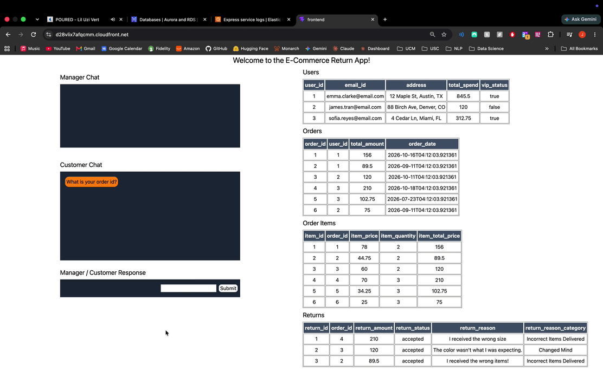
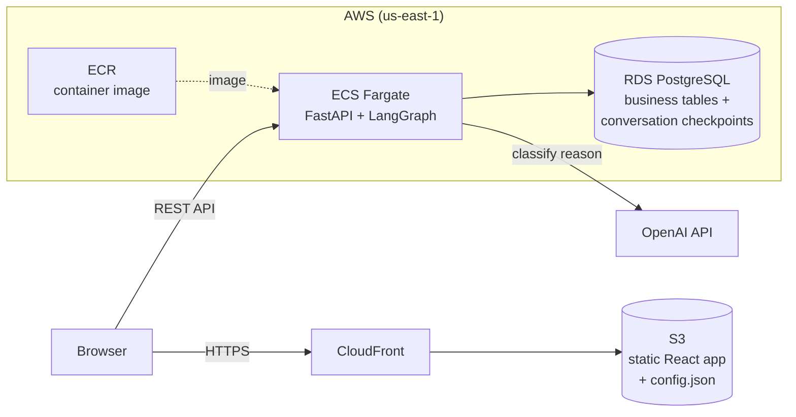
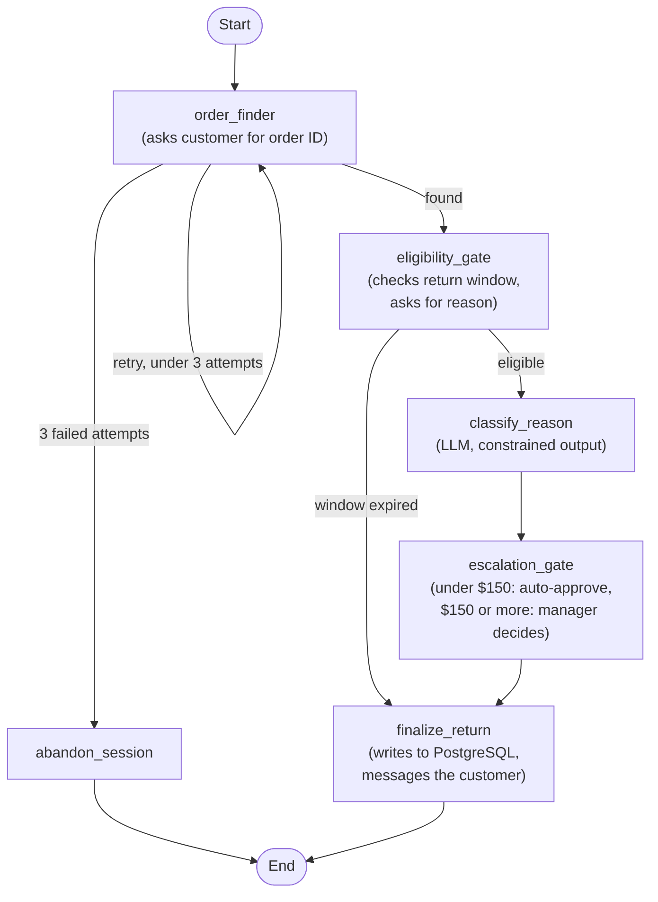
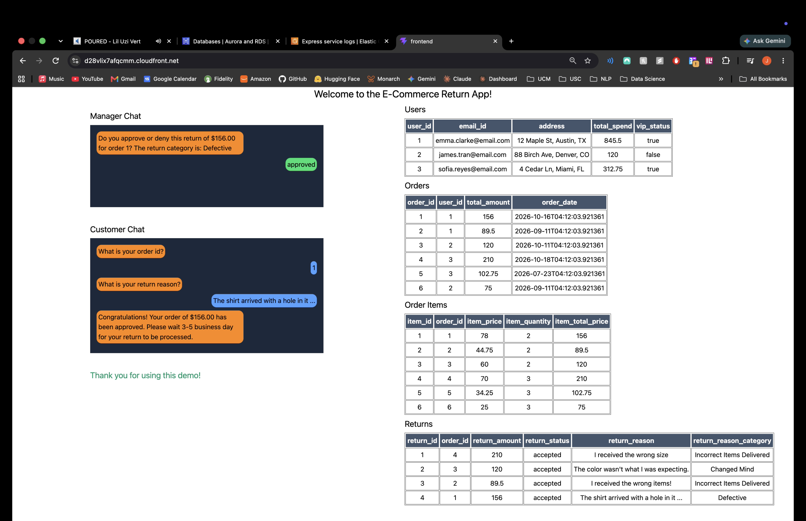
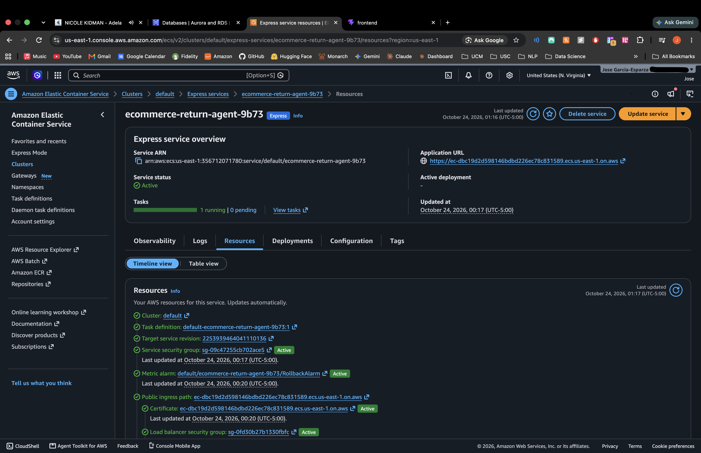
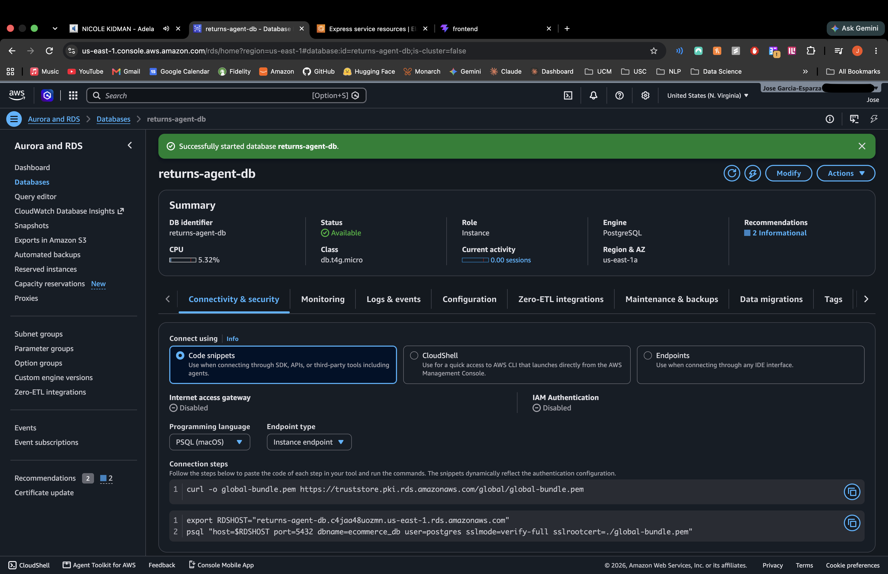
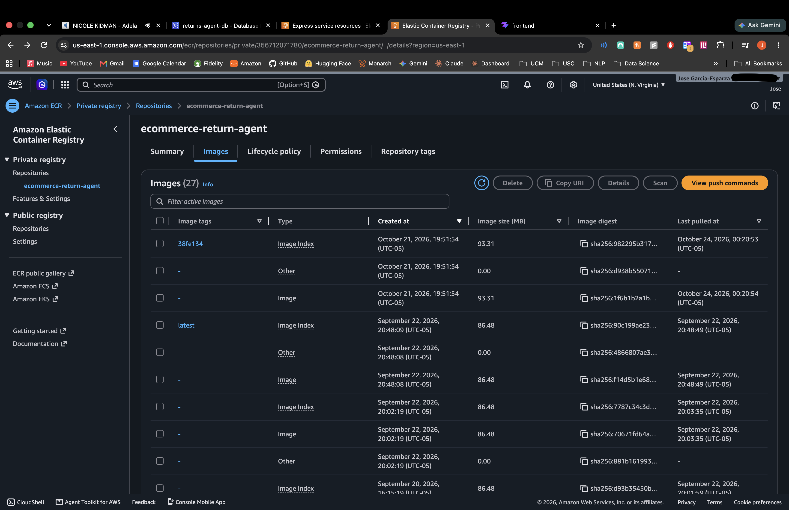

# E-Commerce Return Agent

A stateful AI workflow that walks a customer through an e-commerce return, applies business rules (return windows, VIP status, dollar thresholds), uses an LLM to classify the customer's free-text reason, and pauses for human manager approval on high-value returns. Built with **LangGraph, FastAPI, PostgreSQL, React and TypeScript**, and deployed on **AWS** (ECS Fargate, RDS, ECR, S3 + CloudFront).

**Live frontend:** https://d28vlix7afqcmm.cloudfront.net
The backend is kept offline between demos to avoid paying for idle infrastructure, so the site shows a friendly "demo backend is asleep" message by default. See the demo video and screenshots below, or [run it locally](#run-it-locally).

## Demo

<!-- TODO: replace with your GIF (docs/demo.gif) -->


<!-- TODO: replace the link with your video URL -->
[▶ Watch the full demo video](https://youtu.be/-e05KG7Jw30)

The video is recorded against the local Docker Compose setup. The same code runs on AWS (see [Deployed on AWS](#deployed-on-aws)).

## What it does

1. Asks the customer for an order ID (up to 3 attempts, then ends the session).
2. Checks the **return window**: 30 days for standard customers, 60 days for VIP customers. Expired returns are denied without asking anything further.
3. Asks for a **return reason** and uses an LLM to classify it as *Changed Mind*, *Defective*, *Incorrect Items Delivered*, or *Other*.
4. **Returns under $150 are approved automatically.** Returns of $150 or more pause the graph and ask a manager to approve or deny, showing the manager the AI's category.
5. Saves the outcome to PostgreSQL and tells the customer the result. The tables panel in the UI refreshes automatically.

## Architecture



### The agent graph



The graph pauses (`interrupt`) at three points: the order ID question, the return reason question, and the manager approval. Each pause is saved to PostgreSQL and resumed by the next API call.

## Tech stack

| Layer | Technology |
|---|---|
| Agent orchestration | LangGraph (`StateGraph`, conditional routing, interrupts) |
| LLM | OpenAI model through LangChain, with structured output; model name set by environment variable |
| Backend | Python, FastAPI, Uvicorn, Docker |
| Database | PostgreSQL (business tables and LangGraph checkpoints), `psycopg` / `psycopg2` |
| Frontend | React 19, TypeScript, Vite, Tailwind CSS v4 |
| Cloud | AWS ECS Fargate (Express Mode), RDS, ECR, S3, CloudFront with origin access control, AWS Budgets |
| Local development | Docker Compose |

## Key engineering decisions

- **Human-in-the-loop by design.** High-value returns are not decided by code or by the model. The graph pauses, shows the manager the order and the AI's category, and resumes with the manager's answer. The pending question carries a channel tag so the UI routes it to the right panel (customer or manager).
- **Durable conversation state.** LangGraph checkpoints are stored in the same PostgreSQL database, with one thread per conversation. I tested durability on AWS by stopping the running container in the middle of a conversation: the replacement task resumed the same conversation from where it paused.
- **LLM only where rules can't do the job.** Deadlines and thresholds are plain, testable code. The model's one job is turning a free-text reason into a category. Its output is constrained to four allowed values, and if the call fails the category falls back to *Other*, so an API outage never blocks a return. The category informs the manager, who makes the decision.
- **Runtime configuration for the frontend.** The static site reads the backend address from a `config.json` file at load time instead of baking it into the build. The backend gets a new address each time it is recreated, so re-activating it needs no frontend rebuild.
- **Cost-aware hosting.** Running a load balancer, public IP addresses, containers and a database around the clock is expensive for a demo. The frontend stays live permanently (static hosting is cheap), while the backend is brought up for live demos and torn down afterwards, with budget alerts set as a guardrail.

## Deployed on AWS

The backend was deployed and verified end to end, then torn down. These screenshots are from that deployment.

<!-- TODO: add your screenshots to docs/screenshots/ and keep or rename the paths below -->

| | |
|---|---|
|  |  |
| The deployed frontend (CloudFront) talking to the deployed backend | The service on ECS Fargate |
|  |  |
| RDS PostgreSQL | Container image in ECR |

## Run it locally

**Prerequisites:** Docker, Node.js, and an OpenAI API key.

1. Create a `.env` file in the repository root:

   ```
   POSTGRES_USER=admin
   POSTGRES_PASSWORD=choose-a-password
   POSTGRES_DB=ecommerce_db
   POSTGRES_PORT=5432
   MAIN_PORT=8000
   RESET_SECRET=choose-a-secret
   OPENAI_API_KEY=your-openai-key
   LLM_MODEL=gpt-6-luna
   ```

   `LLM_MODEL` can be any OpenAI chat model that supports structured output.

2. Start the database and backend (the database is created and seeded on first start):

   ```
   docker compose up --build
   ```

3. In a second terminal, start the frontend:

   ```
   cd frontend
   npm install
   npm run dev
   ```

4. Open http://localhost:5173.

To start over with fresh seed data, run `docker compose down -v` and then `docker compose up --build`. Seed order dates are relative to when the database is first created.

### Try it

Seeded orders cover each path through the graph. Type the order ID, then the reason. For manager scenarios, type `approved` or `denied` in the same input box when the manager question appears.

| Order | Customer | Total | Age | Try this reason | Expected result |
|---|---|---|---|---|---|
| 3 | Standard | $120 | 10 days | I changed my mind, I don't want it anymore | Approved automatically, category *Changed Mind* |
| 2 | VIP | $89.50 | 40 days | I received the wrong items! | Approved: past the 30-day standard window but inside the 60-day VIP window |
| 6 | Standard | $75 | 40 days | (none asked) | Denied: same age as order 2, but standard window has expired |
| 1 | VIP | $156 | 5 days | The shirt arrived with a hole in it. | Manager approval requested, showing category *Defective* |
| 4 | VIP | $210 | 3 days | It stopped working after two days. | Manager approval requested, category *Defective* |
| 5 | VIP | $102.75 | 90 days | (none asked) | Denied: past even the 60-day VIP window |

Entering three invalid order IDs ends the session. Because the model is not deterministic, an occasional category may differ.

## Project structure

```
backend/     FastAPI app, LangGraph graph (backend/graph), database schema and seed data
frontend/    React + TypeScript + Vite app (chat panels and live database tables)
docker-compose.yml
```

## Future enhancements

- Evaluation set and tracing for the classification step, to measure accuracy over time
- Let model output influence routing (for example, escalating unclear reasons to a manager)
- Retrieval over the return policy for more nuanced decisions
- A separate, authenticated manager interface instead of the shared demo chat
- Itemized returns and prevention of repeat returns for the same order
- Standard HTTP error codes, automated tests, and infrastructure-as-code with CI/CD